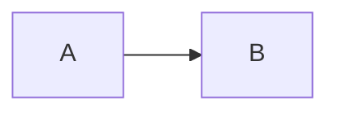

## Title and Image


---

## Split Layout

Some text that sits beside the picture.

- Point one
- Point two


---


---

## Grid Layout
<!-- layout: grid -->

First paragraph cell.

```js
const x = 1;
```

| A | B |
|---|---|
| 1 | 2 |

> [!note]
> A note in a grid cell.

---

## BSP Layout
<!-- layout: bsp -->

Primary pane text.

- Item one
- Item two

```python
print("hi")
```

---

## Code Layout

```typescript
export function greet(name: string): string {
  return `Hello, ${name}!`;
}
```

---

## Math Layout

$$
E = mc^2
$$

---

## Media Layout

!youtube[Intro video](https://www.youtube.com/watch?v=dQw4w9WgXcQ)

---

## Poll Slide

!poll[Vote now](https://example.com/poll)

---


## Background Image

Text over a full-slide background.

---

## Diagram Fallback


